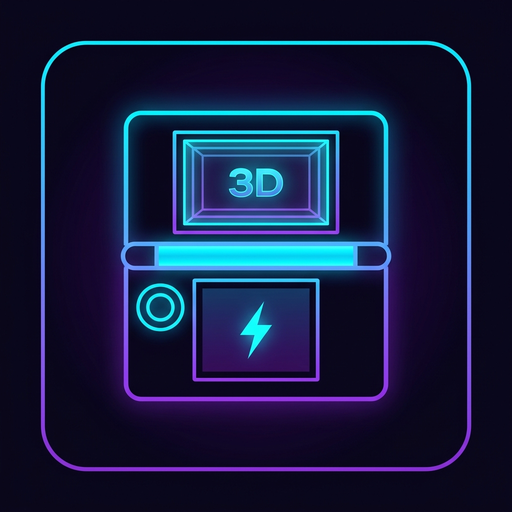

<p align="center">
  
</p>

<h1 align="center">STORM 3DS</h1>

<p align="center">
  <strong>Продвинутый гибридный эмулятор Nintendo 3DS для Android и Windows x64 (Vulkan + OpenGL ES 3.2 + интерфейс STORM)</strong><br />
  Версия <code>1.7.0</code> | Платформы: <code>Android (arm64-v8a, x86_64)</code> и <code>Windows x64</code> | Лицензия: <code>GPL-3.0-or-later</code>
</p>

<p align="center">
  <a href="https://github.com/ReiKatari/STORM_3DS">GitHub Repository</a> -
  <a href="https://github.com/ReiKatari/STORM_3DS/releases/tag/1.7.0">Релиз STORM 3DS 1.7.0</a> -
  <a href="https://stormgamesworld.ru/programs?repo=STORM_3DS">Страница на STORM GAMES WORLD</a>
</p>

---

## О проекте

**STORM 3DS** - это высокопроизводительный эмулятор семейства консолей Nintendo 3DS для Android 10+ (API 29+), объединяющий современное C++20 ядро **Azahar**, оптимизации и спидхаки из **Citra MMJ** и **Borked3DS**, полную поддержку расшифровки образов **AzaharPlus**, сетевые доработки **Mandarine**, а также визуальный интерфейс Android, адаптированный на базе **WatermelonDS** (Jetpack Compose + Material, 9 тем, Live OCR-переводчик с TTS, сканер RAM, шейдеры RetroArch `.slangp`, менеджер Vulkan-драйверов, Quick Resume, статистика игрока и кастомные скины 3DS).

---

## Ключевые особенности и улучшения

### 1. Универсальная поддержка ВСЕХ форматов Nintendo 3DS и архивов
- **Нативные и сжатые форматы (17)**: `.3ds`, `.z3ds`, `.cci`, `.cxi`, `.app`, `.cia`, `.3dsx`, `.elf`, `.axf`, `.zcci`, `.zcxi`, `.zcia`, `.z3dsx` (Z3DS), `.bcci`, `.bcxi`, `.bcia` (Bundle) и `.artic` (Artic Base).
- **Архивы (3)**: `.zip`, `.7z`, `.rar` с автоматической фоновой распаковкой в `STORM 3DS/cache/extracted_3ds/`, сохранением исходного расширения контейнера и LRU-очисткой кэша.
- **Авто-установка `.cia`/`.zcia`/`.bcia`**: поддержка прямой установки обновлений/DLC/игр CIA в один тап через `CiaInstallWorker` или при прямом открытии.
- **Полная расшифровка зашифрованных ROM / NCCH / CIA**: встроенный конвейер ключей `boot9.bin`, `keys.txt`, `aes_keys.txt` и `seeddb.bin` в `STORM 3DS/sysdata/` (включая импорт ключей прямо из меню настроек 3DS и расшифровку локальных CIA без дампа `otp.bin`).
- **Автоматические метаданные и обложки**: чтение SMDH-иконок, названий и Title ID через нативный `GameInfo`, а также загрузка бокс-артов из Libretro `Nintendo - Nintendo 3DS`.

### 2. Графика Vulkan / OpenGL ES 3.2, SPIRV-Tools и RetroArch `.slangp`
- **Borked3DS SPIR-V Optimizer**: оптимизация, валидация и легализация шейдерных байт-кодов через `SPIRV-Tools-opt` (`OptimizeSPIRV`).
- **Zero-copy интеграция `liblibrashader.so`**: динамическая загрузка `dlopen("liblibrashader.so")` с минимальными накладными расходами как для Vulkan (`CopyToSwapchain`), так и для OpenGL ES 3.2 (`TryPresent`).
- **Встроенные пресеты шейдеров (`.slangp` + `.slang`)**: `lcd-3ds`, `crt-scanlines`, `sharp-bilinear`, `vibrant-hd`, `grayscale-pocket`.
- **Текстуры и масштабирование**: внутреннее разрешение `1x..10x`, текстурные фильтры (`Anime4K`, `Bicubic`, `ScaleForce`, `xBRZ`, `MMPX`), асинхронная компиляция шейдеров, загрузка/дамп HD-текстур (`custom_textures`, `dump_textures`, `preload_textures`).
- **Citra MMJ Speedhacks**: FMV Core Downcount Hack, Skip Slow Draw, Skip CPU Texture Copy, Accurate Shader Multiplication, Audio Time Stretching, Separable Shaders.
- **Управление драйверами Vulkan (Adreno Turnip / ARM Mali PanVK `malisx2` / Freedreno)** (`STORM_ENABLE_ADRENOTOOLS=ON`) и адаптивный профиль совместимости Vulkan/GLES в `STORM_3DS_1.5.0.apk`.

### 3. Продвинутый движок стереоскопического 3D
- **7 активных режимов вывода 3D** (`StereoRenderOption`): `Side-by-Side`, `Side-by-Side Full`, `Anaglyph (Dubois)`, `Interlaced`, `Reverse Interlaced`, `Cardboard VR` и фирменный **`Gyro Parallax`** (`vulkan_present_gyro.frag` / `opengl_present_gyro.frag`), реагирующий на наклон устройства.
- **Живой аппаратный слайдер 3D глубины (`0..100`)**: с тактильным щелчком в позиции `OFF` и светящимся изумрудным светодиодом `3D`.
- **Оптимизация рендера правого глаза**: опция `Disable Right Eye Render` для прироста производительности.

### 4. Интерфейс STORM на базе WatermelonDS, 3DS-управление и 30 скинов
- **Оригинальная геометрия экранов 3DS**: верхний экран строго `5:3` (`400x240`), нижний сенсорный экран строго `4:3` (`320x240`), редактор макетов с прямой синхронизацией в C++ (`setCustomScreenLayout`) и поддержкой второго внешнего дисплея (`SecondaryDisplay`).
- **Нативные 3DS-элементы управления**: аналоговый `Circle Pad`, мини-стик `C-Stick` (включая маппинг правого стика геймпада), кнопки `ZL`, `ZR`, `HOME`, слайдер 3D глубины и программируемые макро-кнопки **`Combo 1` / `Combo 2`**.
- **10 новых 3DS-стилей кнопок** (34 стиля всего) и **30 консольных скинов Nintendo 3DS / 2DS / STORM** плюс **3D-анимация раскрытия раскладушки 3DS** при запуске игры (`Console3DBootScreen`).
- **Инструменты, JIT и 3DS-система**: прокачанный ARM11 JIT Dynarmic (режимы `Точный` / `Быстрый` / `Турбо`, `ArchVersion::v6K`, `always_little_endian`, оптимизация констант `.text`/`.rodata`, адаптивный кэш JIT под ОЗУ устройства и HLE DSP аудио по умолчанию) + профиль оптимизации в 1 нажатие для слабых и старых устройств, режим `New 3DS`, разгон ЦП (`25%..200%`), автоопределение языка системы 3DS, профиль Nintendo 3DS (`SystemSaveGame`: никнейм, дата рождения, Play Coins, MAC, Console ID), автоматическая запись логов `STORM_3DS.log` по умолчанию, живой экранный переводчик **ML Kit OCR + TTS**, нативный C++ поиск читов (**RAM Cheat Finder**) + встроенная база MMJ на 123 игры + `3dstdb`, Zstd-буфер перемотки (**Auto-Timeline Rewind**), 29 авто-профилей игр, **Amiibo**, **Artic Base**, **Pretendo / Nimbus** (`api.pretendo.cc`), **NetPlay**, фильтрация логов по regex и `Storm3dsForegroundService`.

---

## Релиз 1.7.0

| Файл релиза | Назначение | Ключевые возможности |
| --- | --- | --- |
| `STORM_3DS_1.7.0.apk` | Подписанная универсальная сборка для Android (`arm64-v8a` + `x86_64`) | Новый **STORM-компилятор** (`FastDispatch` ARM64, прямой `PageTable` + `UXTW`, многопроходная IR-оптимизация, MRU-кэш шейдеров PICA200), единое оформление окна «Система 3DS -> Ключи 3DS, спидхаки, SPIR-V и 3D» с `WatermelonSwitch` и карточками тем |
| `STORM_3DS_1.7.0_Windows_x64.zip` | Подписанная портативная сборка для Windows 10/11 (x64) | Встроенный профиль **STORM-компилятора** (`Максимальный` с кэшем до 192 МБ, многопроходным IR и `IsReadOnlyMemory` кэшем) в настройках Debug/CPU и конфиге, плюс все улучшения интерфейса `STORM Dark`/`STORM Light` и HiDPI |

---

## Сборка из исходного кода

### Требования (Android)
- **JDK**: 21
- **Android SDK**: Platform 36 (`compileSdk = 36`, `minSdk = 29`)
- **Android NDK**: `28.0.13004108`
- **CMake**: `3.22.1` + `Ninja`
- **Rust (`rustup` + `cargo`)**: канал `stable` с целями `aarch64-linux-android` и `x86_64-linux-android` (для сборки `liblibrashader.so`)

### Требования (Windows x64)
- **Visual Studio / MSVC 14.51+**, **CMake**, **Ninja**, **Windows SDK 10.0**, **Qt 6** (`Widgets`, `Multimedia`, `Concurrent`, `LinguistTools`) и **SDL2**

### Команды сборки (Android)
```bash
git clone --recursive https://github.com/ReiKatari/STORM_3DS.git
cd STORM_3DS

# Низконагруженная релизная сборка Android
./gradlew assembleGitHubProdRelease --max-workers=3 -Dorg.gradle.priority=low
```
Готовые артефакты релиза сохраняются в папку `releases/`:
- `releases/STORM_3DS_1.7.0.apk`
- `releases/STORM_3DS_1.7.0_Windows_x64.zip`

---

## Благодарности и открытые проекты (Credits)

Проект **STORM 3DS** создан благодаря труду разработчиков и сообществ следующих проектов, связанных с **Nintendo 3DS** и графическим интерфейсом **WatermelonDS**:

- **[Azahar Emulator](https://github.com/azahar-emu/azahar)** (команда Azahar и авторы объединения PabloMK7 + Lime3DS) - основное C++20 ядро эмуляции Nintendo 3DS, поддержка Z3DS, Artic Base, Bundle и современный Android Vulkan/GLES бэкенд.
- **[Citra Emulator](https://citra-emu.org/)** - оригинальный открытый эмулятор Nintendo 3DS, на чьем фундаменте выросла вся экосистема эмуляции 3DS.
- **[Citra MMJ](https://github.com/weihuoya/citra)** (**weihuoya**) - спидхаки мобильной производительности (`FMV Hack`, `Skip Slow Draw`, `Skip Texture Copy`), алгоритм сканирования виртуальной памяти для поиска читов и база читов/игровых ID (`cheats`, `3dstdb`).
- **[Borked3DS](https://github.com/Borked3DS/Borked3DS)** (релиз `v2025.01.23` и команда Borked3DS) - интеграция оптимизатора шейдеров `SPIRV-Tools-opt` (`OptimizeSPIRV`) с валидацией и легализацией SPIR-V.
- **[AzaharPlus](https://github.com/AzaharPlus/AzaharPlus)**, **Lime3DS** и **Mandarine** - улучшения совместимости расшифровки зашифрованных образов ROM/NCCH/CIA (`boot9`, `aes_keys`, `seeddb`), поддержка старых форматов без лишних ограничений и сетевые улучшения.
- **[WatermelonDS](https://github.com/SapphireRhodonite/WatermelonDS)** (**SapphireRhodonite** и участники) - основа пользовательского Android-интерфейса (визуальная архитектура на Jetpack Compose + Material, темы, Live OCR+TTS переводчик, менеджер Vulkan-драйверов, редактор макетов и элементы управления).
- **[librashader](https://github.com/SnowflakePowered/librashader)** (**SnowflakePowered**) - движок постобработки RetroArch `.slangp` шейдеров для Vulkan и OpenGL ES.
- **[SPIRV-Tools](https://github.com/KhronosGroup/SPIRV-Tools)** и **Khronos Vulkan SDK / Glslang / VMA** - компиляция, оптимизация и управление памятью Vulkan-шейдеров.
- **[libadrenotools](https://github.com/bylaws/libadrenotools)** (**Bylaws / Bystander**) - безопасная загрузка пользовательских Turnip/Vulkan-драйверов на устройствах Qualcomm Adreno.
- **Эмуляторные библиотеки ядра и утилит 3DS**: **Dynarmic** (ARM JIT рекомпилятор), **Teakra** (DSP LLE), **SoundTouch**, **Cubeb**, **Zstandard (`zstd`)**, **Crypto++**, **Boost**, **xxHash**, **libyuv**, **faad2**, **enet**, **Sirit**, **Google ML Kit** (распознавание и офлайн-перевод текста), **Apache Commons Compress**, **junrar**, **XZ for Java**, **Coil** и **Markwon**.

---

## Конфиденциальность, лицензии и RetroAchievements

- **Политика конфиденциальности:** [PRIVACY_POLICY.md](PRIVACY_POLICY.md) (локальное хранение данных, ноль рекламы/телеметрии, точный перечень сетевых узлов и соответствие GDPR).
- **Лицензии компонентов открытого ПО:** [LICENSES.md](LICENSES.md) (полный список ядер и библиотек FOSS с лицензиями и ссылками на апстрим).
- **Идентификация RetroAchievements:** в ранних сборках до `1.12.0` использовался унаследованный от форка заголовок `RetroArch/1.19.1 (Android) rcheevos/11.7.0`. Начиная с изменений после `1.12.0`, STORM 3DS использует исключительно собственный `User-Agent` (`STORM_3DS/<version> (Android <os>) azahar_core/<version>`) и шифрует токен сессии через Android Keystore (`AES/GCM`).

---

## Лицензия

Исходный код STORM 3DS распространяется под лицензией **GNU General Public License v3.0 или новее** ([LICENSE](LICENSE)).
Монетизация, реклама и платные ограничения в проекте полностью отсутствуют.
